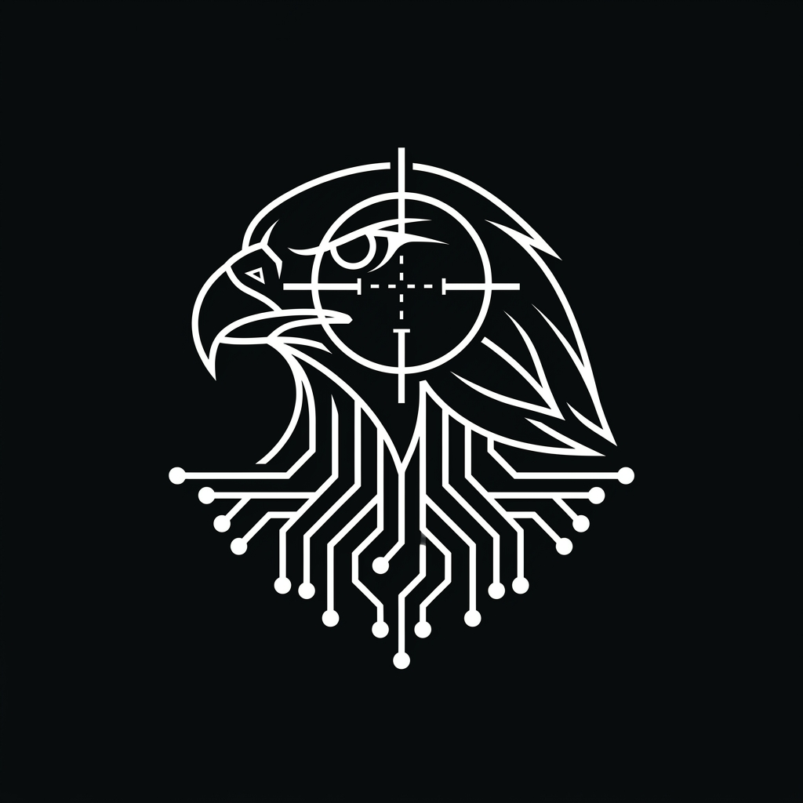

<p align="center">
  
</p>

<h1 align="center">PersistHunt</h1>

<p align="center">
  <strong>Enterprise-Grade Linux Persistence Detection & Security Auditing Framework</strong>
</p>

<p align="center">
  <a href="https://github.com/0xraiven/persistHunt/actions/workflows/ci.yml"></a>
  <a href="LICENSE"></a>
  <a href="pyproject.toml"></a>
  <a href="tests/"></a>
  <a href="pyproject.toml"></a>
  <a href="CHANGELOG.md"></a>
</p>

<p align="center">
  <a href="#overview">Overview</a> •
  <a href="#key-capabilities">Key Capabilities</a> •
  <a href="#mitre-attck-matrix">MITRE ATT&CK Matrix</a> •
  <a href="#architecture">Architecture</a> •
  <a href="#quickstart">Quickstart</a> •
  <a href="#cli-reference">CLI Reference</a> •
  <a href="#risk-scoring">Risk Scoring</a> •
  <a href="#security-invariants">Security Invariants</a> •
  <a href="#contributing">Contributing</a>
</p>

---

## Overview

**PersistHunt** is a specialized, zero-dependency security framework engineered for incident responders, system administrators, and security auditors to detect stealthy persistence mechanisms, unauthorized backdoors, and post-exploitation footholds across Linux operating systems.

Modern Linux threats frequently establish longevity through esoteric scheduling hooks, drop-in systemd directives, hijacked shell environments, rogue SSH authorization keys, elevated SUID binaries, and unlinked in-memory process executions. PersistHunt systematically audits all primary persistence vectors in an **entirely read-only, non-invasive, and deterministic** manner.

---

## Key Capabilities

- **Zero Runtime Dependencies**: Built exclusively on the Python standard library. Deploys instantaneously on any host without `pip install` or external network packages.
- **Strict Read-Only & Non-Interfering Assurance**: Never executes discovered commands, never modifies filesystem state, never alters user accounts or services, and never opens network connections.
- **Air-Gapped Forensic Safety**: Automatically redacts sensitive secrets (password hashes in `/etc/shadow`, private key headers, sensitive CLI tokens).
- **Offline & Container Root Inspection**: Fully supports offline analysis of forensic disk images, mounted root filesystems, or container layers via the `--root-prefix` parameter.
- **Robust Resource Boundaries**: Hardened against named pipe (FIFO) blocking, symlink loops, and denial-of-service attempts via file-size traversal caps.
- **Isolated Fault-Tolerant Engine**: Each detector executes in an isolated harness. An inaccessible or malformed directory in one subsystem will never impede the rest of the audit.
- **Multi-Modal Reporting**: Emits formatted interactive terminal tables, machine-parseable JSON adhering to a standardized schema, and standalone air-gapped HTML reports.

---

## MITRE ATT&CK Matrix

PersistHunt maps detected persistence telemetry directly to the **MITRE ATT&CK® Enterprise Framework**:

| Vector | Detector Class | MITRE Technique | Primary Inspection Target | Core Indicators Flagged |
|---|---|---|---|---|
| **cron** | `CronDetector` | [T1053.003](https://attack.mitre.org/techniques/T1053/003/) | `/etc/crontab`, `/etc/cron.*`, `/var/spool/cron/*` | Piped web payloads (`curl \| bash`), raw network sockets (`/dev/tcp`), temp path execution (`/tmp`), base64 decoding, hidden dotfiles. |
| **systemd** | `SystemdDetector` | [T1543.002](https://attack.mitre.org/techniques/T1543/002/) | `/etc/systemd/system`, `/usr/lib/systemd/system`, user units, drop-ins | Network redirection, binaries executing from temporary/hidden paths, inline shell interpreters, dangling service symlinks. |
| **ssh** | `SSHDetector` | [T1098.004](https://attack.mitre.org/techniques/T1098/004/) | `/root/.ssh/*`, `/home/*/.ssh/*`, `/etc/ssh/sshd_config` | Insecure forced commands (`command=...`), non-login service accounts with keys, world-writable authorized_keys, dangerous `sshd` directives. |
| **shell** | `ShellDetector` | [T1546.004](https://attack.mitre.org/techniques/T1546/004/) | `/etc/profile*`, `~/.bashrc`, `~/.profile`, `~/.zshrc` | Reverse shell strings, alias hijacking (`alias sudo=...`), executable staging in `/tmp`, unverified remote script downloads. |
| **suid** | `SuidDetector` | [T1548.001](https://attack.mitre.org/techniques/T1548/001/) | `/bin`, `/sbin`, `/usr/bin`, `/usr/local/bin`, `/opt`, `/tmp`, `/home` | Elevated SUID/SGID binaries, world-writable SUID executables, SUID shells (`bash`, `sh`, `python`), SUID in non-standard paths. |
| **process** | `ProcessDetector` | [T1059](https://attack.mitre.org/techniques/T1059/) / [T1055](https://attack.mitre.org/techniques/T1055/) | `/proc/[pid]/*` | Processes executing unlinked binaries (`(deleted)`), daemons spawning interactive shells, binaries executing from `/dev/shm` or `/tmp`. |
| **account** | `AccountDetector` | [T1136](https://attack.mitre.org/techniques/T1136/) / [T1078](https://attack.mitre.org/techniques/T1078/) | `/etc/passwd`, `/etc/shadow`, `/etc/group` | Non-root UID 0 accounts, dormant service accounts assigned interactive shells, accounts with blank passwords, hidden home directories. |

---

## Architecture

PersistHunt is built with strict architectural decoupling between enumeration, risk quantification, and presentation:

```text
Host Filesystem & Telemetry Targets (/etc, /proc, /home, /var, etc.)
                               │
                               ▼
        ┌──────────────────────────────────────────────┐
        │        Isolated Detector Subsystem           │
        │    (Per-Detector Boundary & Error Shields)   │
        └──────────────────────┬───────────────────────┘
                               │
    ┌──────────────┬───────────┼───────────┬──────────────┐
    ▼              ▼           ▼           ▼              ▼
[CronDetector] [Systemd]    [SSH]       [Shell]     [SUID/SGID]
               [Process]   [Account]     [...]
                               │
                               ▼
                    [FindingCollection]
                               │
                               ▼
        ┌──────────────────────────────────────────────┐
        │          Risk Normalization Engine           │
        │     (Deterministic Mathematical Weights)     │
        └──────────────────────┬───────────────────────┘
                               │
                               ▼
                      [ScanReport Engine]
            ┌──────────────────┼──────────────────┐
            ▼                  ▼                  ▼
     Terminal Console     JSON Schema        HTML Report
     (Interactive UI)   (Machine-Parsable)  (Self-Contained)
```

Every audit detector inherits from the abstract `BaseDetector` interface (`persisthunt.detectors.base`), exposing an isolated, predictable `scan() -> FindingCollection` contract.

---

## Quickstart

### Prerequisites

- **Operating System**: Linux (Kernel 3.10+)
- **Runtime**: Python 3.8, 3.9, 3.10, 3.11, 3.12, 3.13, or 3.14+
- **Privileges**: Standard user permissions for baseline audits; root/`sudo` for complete inspection of protected system files (`/etc/shadow`, `/root/.ssh`).

### 1. Zero-Install Instant Audit

Execute PersistHunt directly as a standalone module without installing packages:

```bash
# Clone the repository
git clone https://github.com/0xraiven/persistHunt.git
cd persistHunt

# Run immediate system audit
python3 -m persisthunt scan
```

### 2. Standard Installation

```bash
# Install globally or in a virtual environment
pip install .

# Or install with developer testing dependencies
pip install -e ".[dev]"
```

---

## CLI Reference

```text
persisthunt [-h] [-V] {scan,version} ...
```

### Common Commands

```bash
# Full system audit with interactive terminal summary
persisthunt scan

# Emit machine-readable JSON to stdout
persisthunt scan --json --quiet

# Target specific persistence subsystems
persisthunt scan --category cron,systemd,ssh

# Filter findings by minimum severity threshold
persisthunt scan --severity high

# Export audit findings to standalone HTML or JSON files
persisthunt scan -o report.html
persisthunt scan -o report.json

# Audit an offline container filesystem or forensic disk image
persisthunt scan --root-prefix /mnt/forensic_image
```

### Command Options Reference (`persisthunt scan`)

| Flag | Parameter | Description |
|---|---|---|
| `--json` | — | Output scan results formatted as JSON on standard output (`stdout`). |
| `-c`, `--category` | `CATEGORIES` | Comma-separated list of categories to audit (`cron`, `systemd`, `ssh`, `shell`, `suid`, `process`, `account`, or `all`). |
| `-s`, `--severity` | `SEVERITY` | Minimum severity filter threshold: `info`, `low`, `medium`, `high`, `critical`. |
| `-o`, `--output` | `FILE` | Write report directly to file (automatically detects format from `.json` or `.html` extension). |
| `-q`, `--quiet` | — | Suppress real-time status output on `stderr`. |
| `--exit-zero` | — | Force exit code 0 even when HIGH/CRITICAL threats are flagged (ideal for non-blocking CI pipelines). |
| `--root-prefix` | `PATH` | Alternative root prefix for offline disk images, mounted snapshots, or container layers. |
| `-h`, `--help` | — | Show command arguments and flags. |

---

## Operational Recipes

### Automated CI/CD Deployment Gates

Block deployment pipelines when actionable high-severity persistence mechanisms are found:

```bash
# Run scan and verify exit code (Exit code 2 = Threat Detected)
persisthunt scan --severity high --quiet
EXIT_CODE=$?

if [ $EXIT_CODE -eq 2 ]; then
  echo "[-] Security Gate Failed: High-severity persistence detected!"
  exit 1
elif [ $EXIT_CODE -eq 0 ]; then
  echo "[+] Security Gate Passed: No high-severity threats found."
fi
```

### Incident Response Triage with `jq`

Filter critical findings from JSON output:

```bash
persisthunt scan --json --quiet | jq '.findings[] | select(.severity == "CRITICAL" or .severity == "HIGH")'
```

### Forensic Offline Image Audit

Audit a read-only mounted forensic image or container root directory:

```bash
persisthunt scan --root-prefix /mnt/evidence/rootfs -o /var/evidence/audit_report.html
```

---

## Risk Scoring

PersistHunt implements a deterministic, mathematically explainable risk scoring system (0.0 to 10.0) rather than subjective averages.

### Severity Weighting

$$\text{CRITICAL} = 10.0 \quad\mid\quad \text{HIGH} = 6.0 \quad\mid\quad \text{MEDIUM} = 3.0 \quad\mid\quad \text{LOW} = 1.0 \quad\mid\quad \text{INFO} = 0.0$$

### Mathematical Formulation

$$\text{Raw Score} = \sum_{f \in \text{findings}} \text{Weight}(f.\text{severity})$$

$$\text{Risk Score} = \min\left(10.0, \text{round}\left(\frac{\text{Raw Score}}{5.0}, 1\right)\right)$$

### Engine Guarantees

- **Monotonicity**: Adding low or informational findings never dilutes or decreases the computed risk score.
- **Bounded**: The score scales smoothly between `0.0` and `10.0`.
- **Explainability**: Full scoring factors and contributing weights are serialized within reports via `report.explain()`.

---

## Security Invariants

1. **Non-Destructive Read-Only Operation**:
   PersistHunt never writes to disk, modifies permissions, alters services, or runs audited scripts.
2. **Zero Inbound or Outbound Network Activity**:
   Completely safe for air-gapped forensic enclaves.
3. **Secret Shielding & Redaction**:
   Password hashes in `/etc/shadow` are never captured or echoed. Private SSH keys and command-line secret parameters are sanitized automatically.
4. **Denial-of-Service Defense**:
   File readers check file status (`stat.S_ISREG`) to bypass named pipes (`mkfifo`) and enforce a strict 10 MB configuration file ceiling. Directory traversals enforce cycle detection with bounded recursion limits.

---

## Automated Test Suite

PersistHunt maintains a comprehensive unit and integration test suite with 100% deterministic coverage:

```bash
# Run full automated test suite across all detectors
pytest -v

# Run the comprehensive 11-stage end-to-end simulation
python3 demo.py
```

---

## Roadmap

- [ ] **Wazuh Agent Integration**: Native decoders and rules for PersistHunt JSON alerts.
- [ ] **eBPF System Call Auditing**: Real-time event detection for runtime persistence installation.
- [ ] **systemd Timer Frequency Analysis**: Automated detection of high-frequency stealth timers.
- [ ] **Auditd Rule Generation**: Exporting proactive auditd rules matching discovered persistence mechanisms.

---

## Community & Contributing

We welcome contributions from security researchers, defenders, and developers!

- **Contributing Guide**: Consult [CONTRIBUTING.md](CONTRIBUTING.md) for architectural guidelines and steps to author new persistence detectors.
- **Security Disclosures**: Please report security vulnerabilities responsibly according to [SECURITY.md](SECURITY.md).
- **Release History**: Detailed version release notes are available in [CHANGELOG.md](CHANGELOG.md).

---

## License

This project is licensed under the terms of the [MIT License](LICENSE).

---

## Disclaimer

*PersistHunt is designed exclusively for authorized defensive security auditing, digital forensics, and incident response. It must only be operated on systems where explicit authorization has been granted.*
